# Feature tour

Native application views cover setup, voice settings, screen context, assistant profiles, provider setup and update readiness.

[Overview](README.md) · [Capture provenance](SCREENSHOTS.md)

[Assistant and dictation](#assistant-and-dictation) · [Screen and desktop](#screen-and-desktop) · [Profiles and providers](#profiles-and-providers) · [Updates](#updates) · [Onboarding](#onboarding)

## Assistant and dictation

### Assistant behavior

Configure how the assistant responds and how requests are handled.

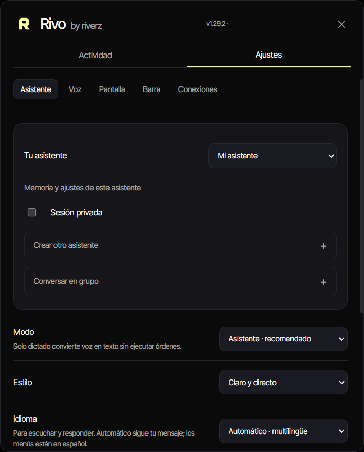

*Archived v1.29.2 native QA; Spanish/dark with isolated in-memory defaults.*

### Voice and shortcut settings

Choose voice and dictation behavior, the microphone and activation shortcuts.

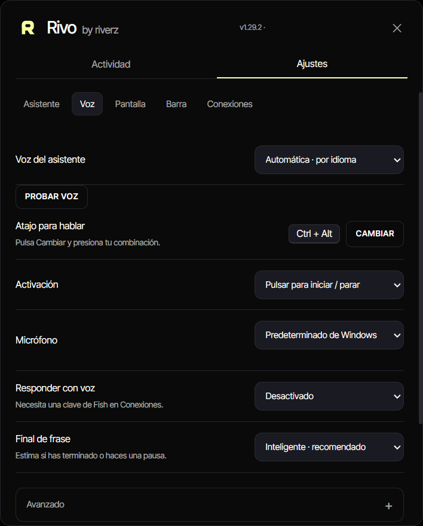

*Archived v1.29.2 native QA; Spanish/dark with fixture devices.*

## Screen and desktop

### Screen context

Configure visible-screen context, screenshot handling and pointing behavior.

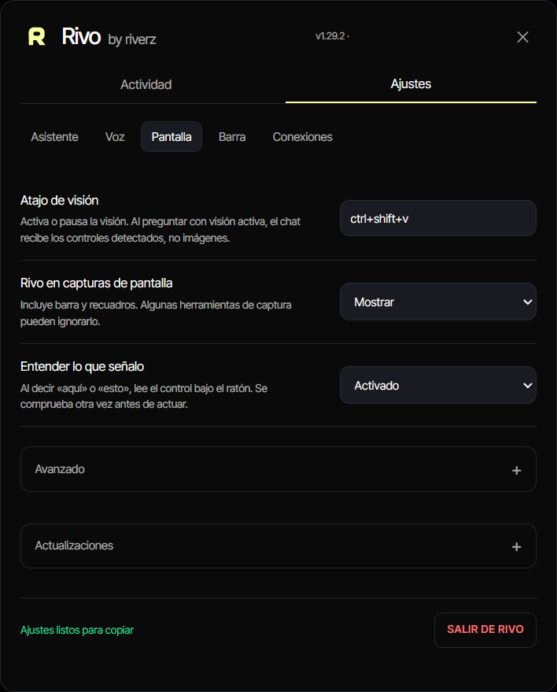

*Archived native application QA; Spanish/dark. Versions vary across this archive; use Releases for the current download.*

### Desktop bar

Choose the bar position and its behavior after an action.

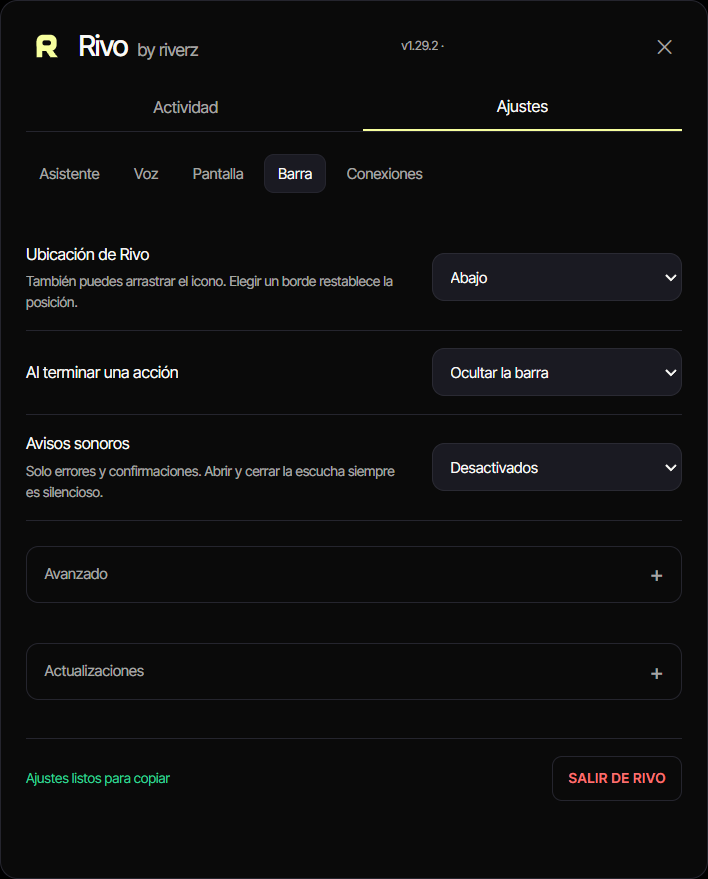

*Archived native application QA; Spanish/dark. Versions vary across this archive; use Releases for the current download.*

## Profiles and providers

### Assistant profiles

Select an assistant profile and inspect session, group and response-style choices.

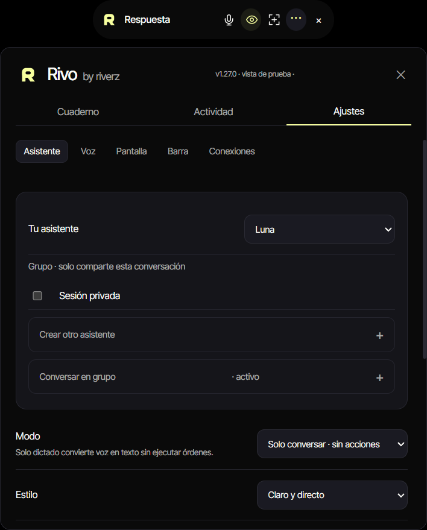

*Archived native application QA; Spanish/dark. Versions vary across this archive; use Releases for the current download.*

### Provider connections

Inspect the provider setup without exposing saved credentials.

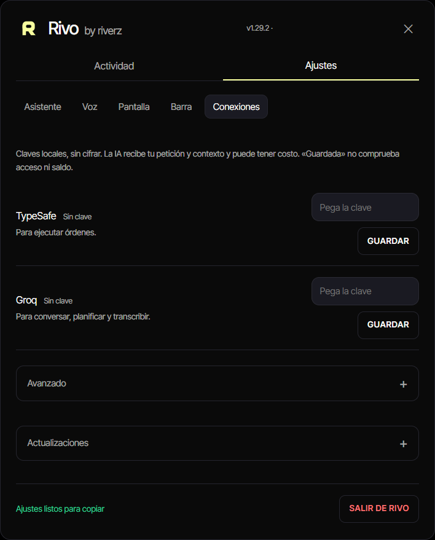

*Archived native application QA; Spanish/dark. Versions vary across this archive; use Releases for the current download.*

## Updates

### Update readiness

Inspect a ready-to-install update and its restart control.

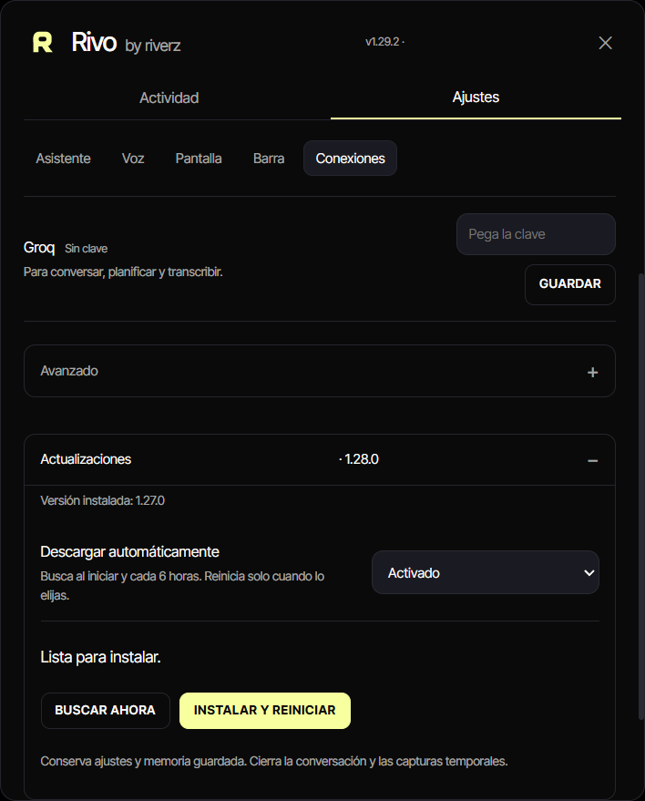

*Archived native application QA; Spanish/dark. Versions vary across this archive; use Releases for the current download. Update version/status are simulated QA state, not a release announcement.*

## Onboarding

### Choose a working mode

Start setup by choosing the working mode and language preference.

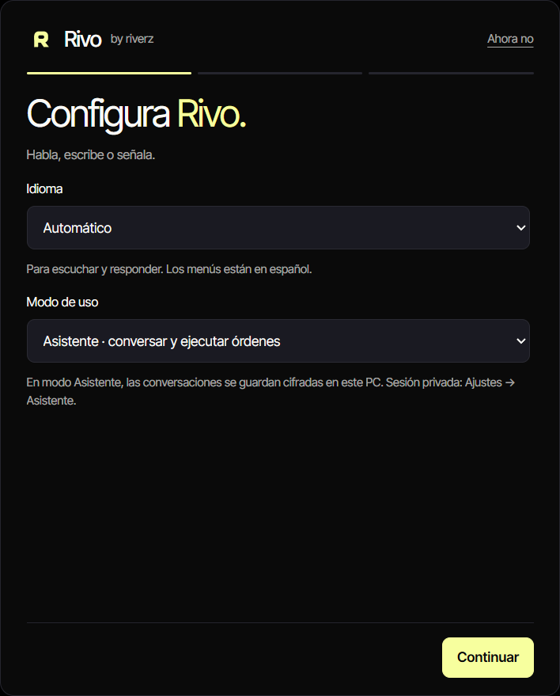

*Archived native application QA; Spanish/dark. Versions vary across this archive; use Releases for the current download.*

### Connect providers

Inspect setup connection state before proceeding.

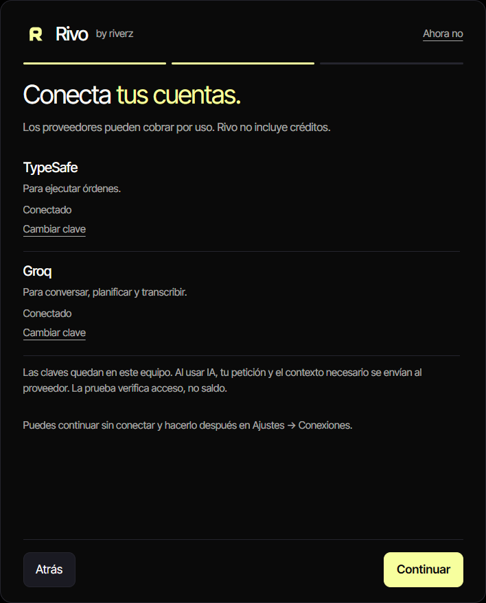

*Archived native application QA; Spanish/dark. Versions vary across this archive; use Releases for the current download. Connection and response state are test fixtures.*

### Microphone setup

Choose a microphone and test its activation behavior.

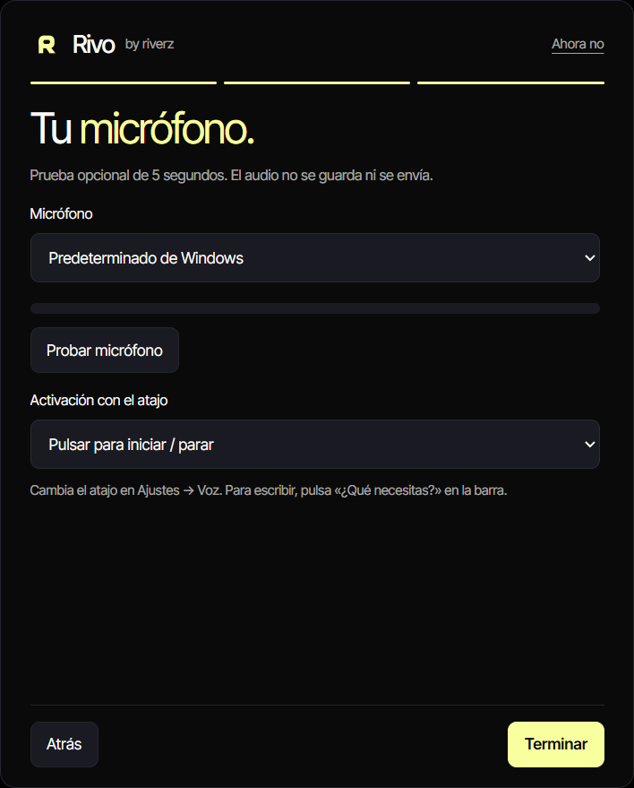

*Archived native application QA; Spanish/dark. Versions vary across this archive; use Releases for the current download.*

### Practice before use

Try the application controls in the setup practice step.

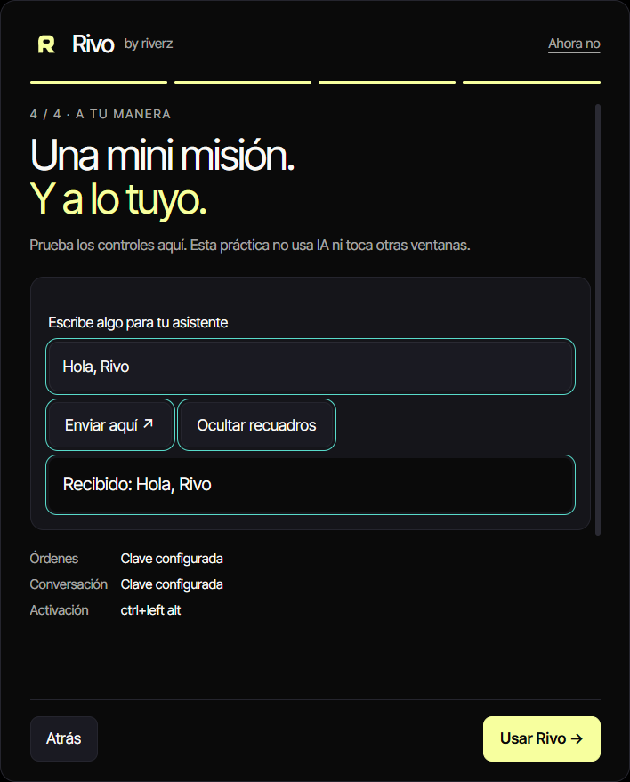

*Archived native application QA; Spanish/dark. Versions vary across this archive; use Releases for the current download. Connection and response state are test fixtures.*

## Coverage and implementation notes

| Area | Coverage boundary |
| --- | --- |
| Voice, literal dictation and Windows actions | Configuration and onboarding are pictured. The QA captures do not prove live speech recognition or a completed desktop action. |
| Screen context and assistant profiles | Settings are pictured; no private desktop content or conversation is published. |
| Provider and update flows | Connection and update statuses come from isolated QA state. They are not evidence of a paid provider request or a newly released version. |
| Current installer | Use [Releases](https://github.com/excelenciaempire/rivo-releases/releases/latest). The tour contains historical UI versions. |

[Back to overview](README.md)
