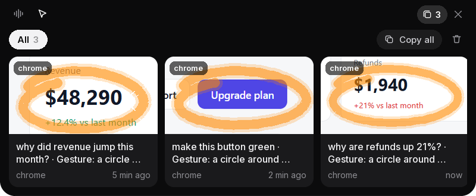
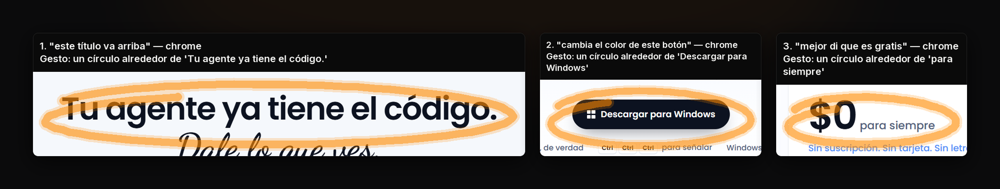
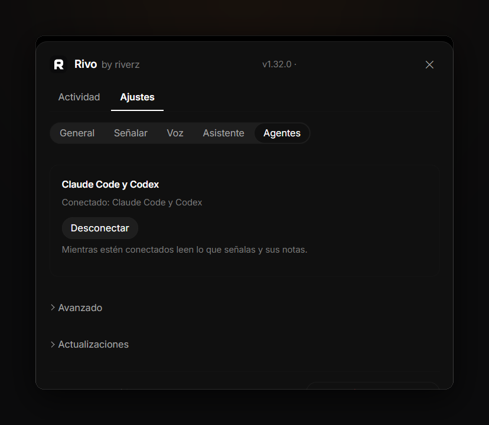
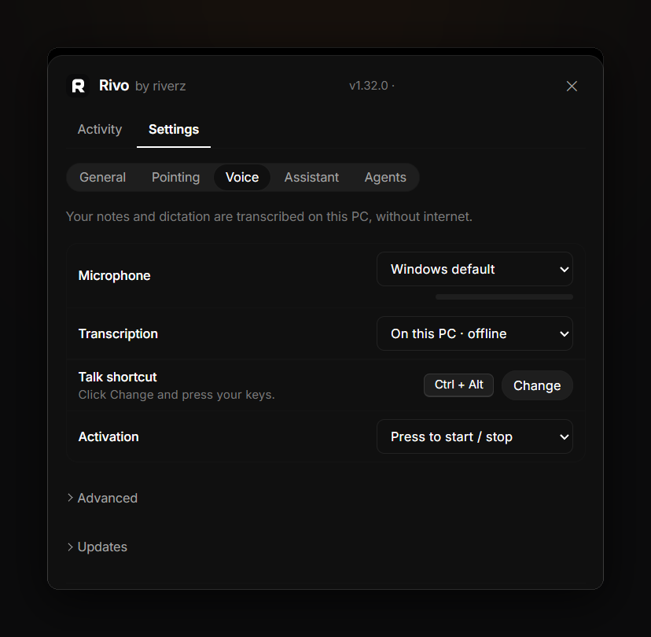
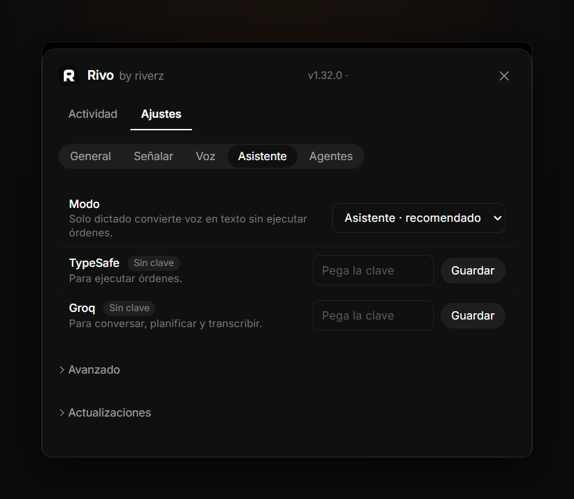

# Rivo features

[Overview](README.md) · [Engineering](ENGINEERING.md) · [Download](https://github.com/excelenciaempire/rivo-releases/releases/latest)

## Pointing

| Gesture | What the card says (example) |
| --- | --- |
| Circle or box | *a circle around 'Upgrade plan'* |
| Underline | *underlining 'Total'* |
| Arrow or line | *an arrow from 'Revenue' down to 'Recent Activity'* |
| Scribble | *a scribble over 'Draft'* |

- **Ctrl ×3** opens the bar from anywhere; **Esc** closes it. Clicks keep reaching your apps while you draw.
- Strokes drawn close together, or with Ctrl held, join the same card.
- The text under a stroke comes from Windows accessibility, and from on-device Windows OCR when an app doesn't expose it.
- Up to 8 cards per session; delete any card from the tray.

## Copy all

One click puts every capture on the clipboard as an image with its caption, plus a text version. The text names each image file, so terminals like Claude Code or Codex can open them.

## Agents

- One click in **Settings → Agents** connects Claude Code and Codex.
- The agent can read the current captures or wait until you finish pointing.

## Voice

- Voice notes while pointing and dictation, transcribed on the PC without internet.
- Push-to-talk or toggle, with your own shortcut.
- Automatic language detection.

## Optional assistant

With your own TypeSafe and Groq keys, Rivo can carry out requests on your PC (open apps, type, click supported targets). Pointing, notes, Copy all and agents don't need any key.

## Updates

Rivo checks this repository for new versions and installs them when you restart it. Release notes are on the [releases page](https://github.com/excelenciaempire/rivo-releases/releases).

[Back to overview](README.md)
