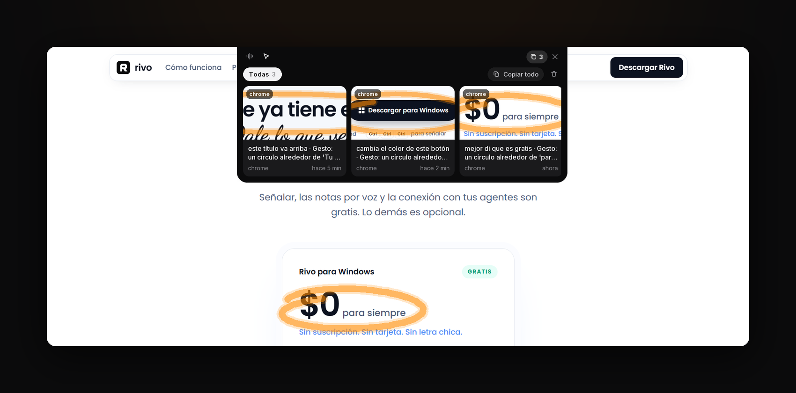
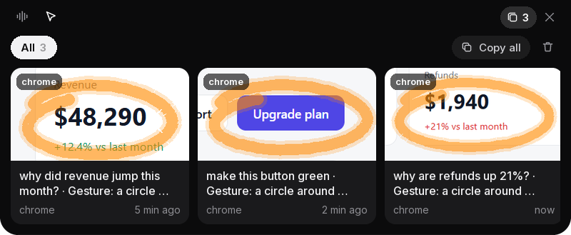
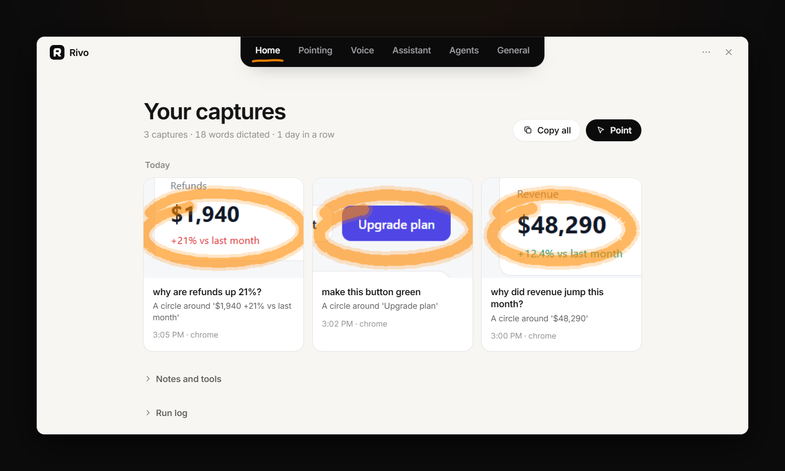
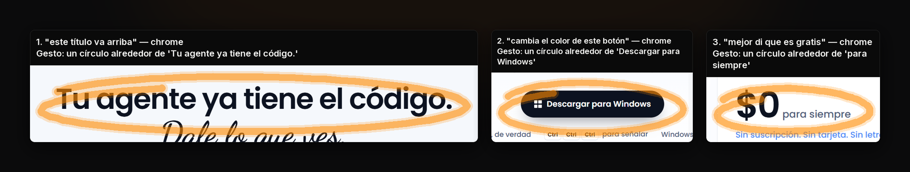
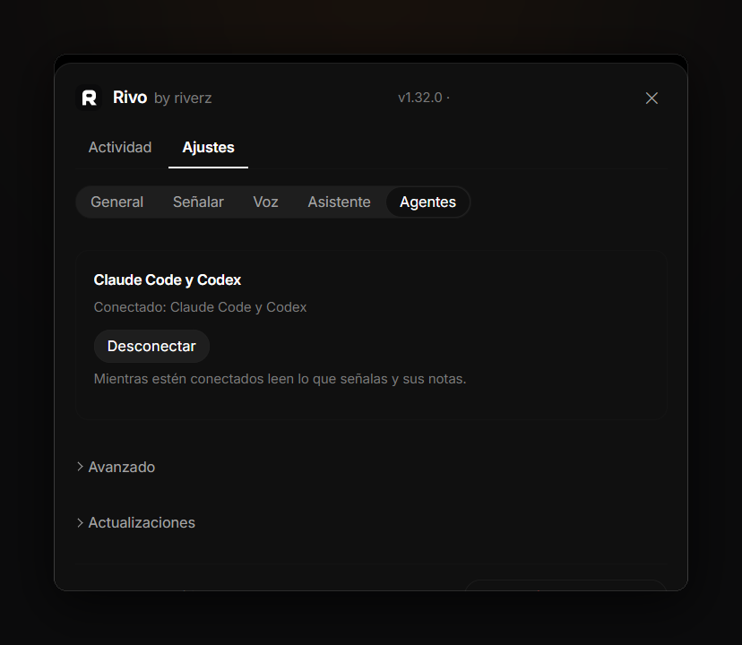
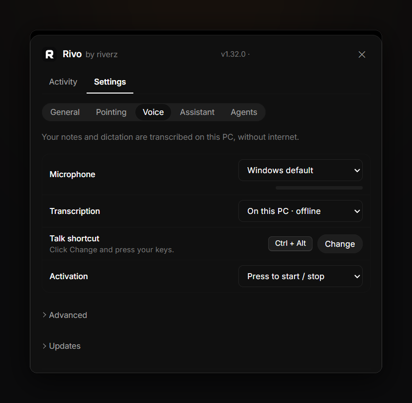
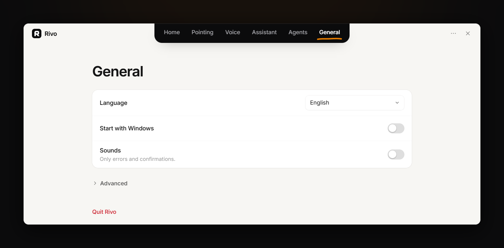
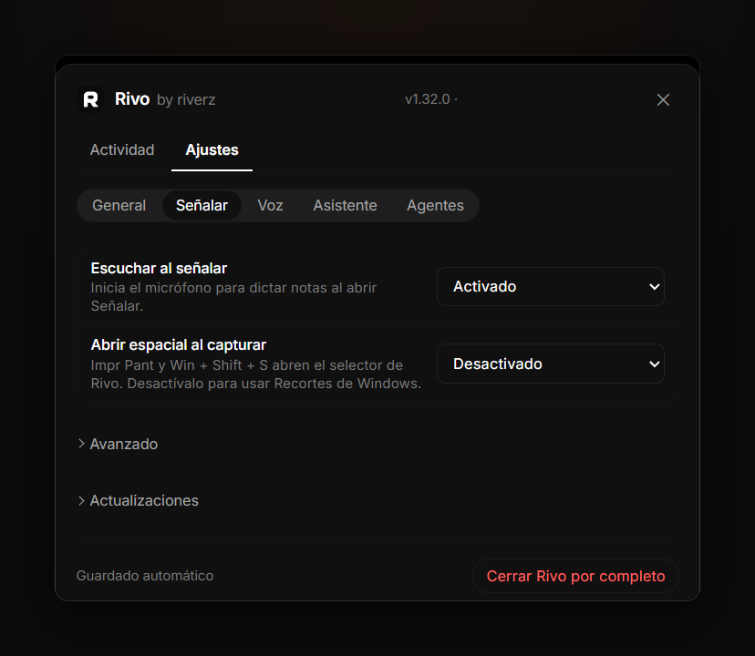
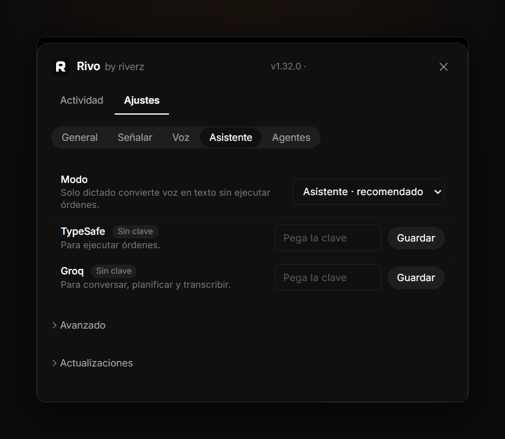

# Rivo

**Point at your screen, say what you want, and your agent sees exactly what you mean.**

Circle something, underline it or draw an arrow. Rivo captures that spot, writes down what you said, reads the text under your stroke, and hands it all to Claude Code, Codex or any chat.

&nbsp;

Free · Windows 10 and 11 · No account, no keys

 

  

## How it works

1. **Press Ctrl three times.** The Rivo bar drops from the top of the screen. Your clicks keep working.
2. **Draw and talk.** Circle, underline, box or arrow, and say what you want. Each stroke becomes a card.
3. **Hand it over.** **Copy all** pastes the pictures and the text in any chat or terminal. Connected agents get it directly.

## Every card explains itself

Rivo tells your agent what your stroke means, not just where it is. Each card carries what you said and a sentence like *"a circle around 'Upgrade plan'"* or *"an arrow from 'Revenue' down to 'Recent Activity'"*. The text comes from Windows accessibility first and from on-device OCR when an app doesn't expose it.

  

## Everything you pointed at, in one place

Rivo's home shows your captures as cards, grouped by day: the picture, what you said and what the stroke means. Copy or delete any of them, or copy them all at once.

  

## What lands in your chat

**Copy all** puts every capture on the clipboard as a picture with its caption on top, plus a text version that names each image file, so it also works in a terminal.

  

## Built for coding agents

Connect Claude Code and Codex with one click. Then ask your agent to *"look at what I'm pointing at"*: it waits while you draw and receives each capture with your note and the gesture sentence.

  

## Your voice stays on your PC

Notes and dictation are transcribed on your computer, without internet. What you point at stays on your PC until you paste it somewhere or a connected agent asks for it.

  

## In English or Spanish

Switch the whole app between English and Spanish in General → Language; it follows your Windows language out of the box. The language you speak is a separate setting, and Rivo understands many.

  

<b>More: pointing options and assistant mode</b>

 

With your own TypeSafe and Groq keys, Rivo also becomes a voice assistant that carries out actions on your PC. It's optional; pointing, voice notes and agents work without it.

  
  

## Download

1. Download **[Rivo-Setup.exe](https://github.com/excelenciaempire/rivo-releases/releases/latest/download/Rivo-Setup.exe)** and run it.
2. Press **Ctrl three times** anywhere to start pointing.

Rivo updates itself from this repository. Every version and its notes are on the [releases page](https://github.com/excelenciaempire/rivo-releases/releases).

## About these images

Made with Rivo 1.33 in English over a sample dashboard. The ink, the tray, the captions and the gesture sentences were drawn by Rivo's own code, and the windows are the app's real interface with test settings, so no personal data appears. More detail in [FEATURES.md](FEATURES.md) and [ENGINEERING.md](ENGINEERING.md).

## About the project

I build Rivo end to end: the pointing layer and tray, gesture reading, voice, Windows integration, the agent connection, settings, onboarding, packaging and updates. **Python · Windows UI Automation · on-device speech and OCR · MCP**.

All my development work here was done with AI assistance. I use programming and software-engineering fundamentals to define requirements, review code, test behavior and take responsibility for technical decisions. This repository distributes the installers and update files; the source code is private.

[Contact](https://github.com/excelenciaempire/riverz-showcase/issues/new?title=Professional%20inquiry)
