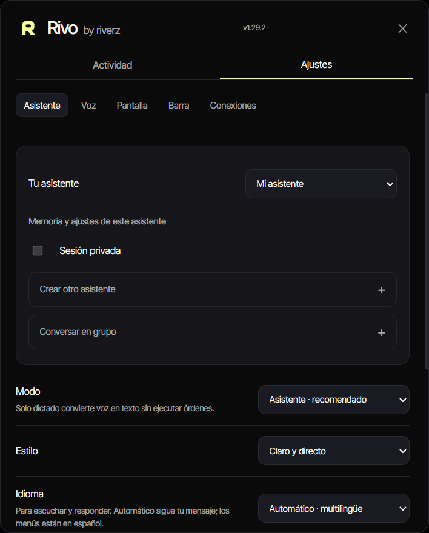
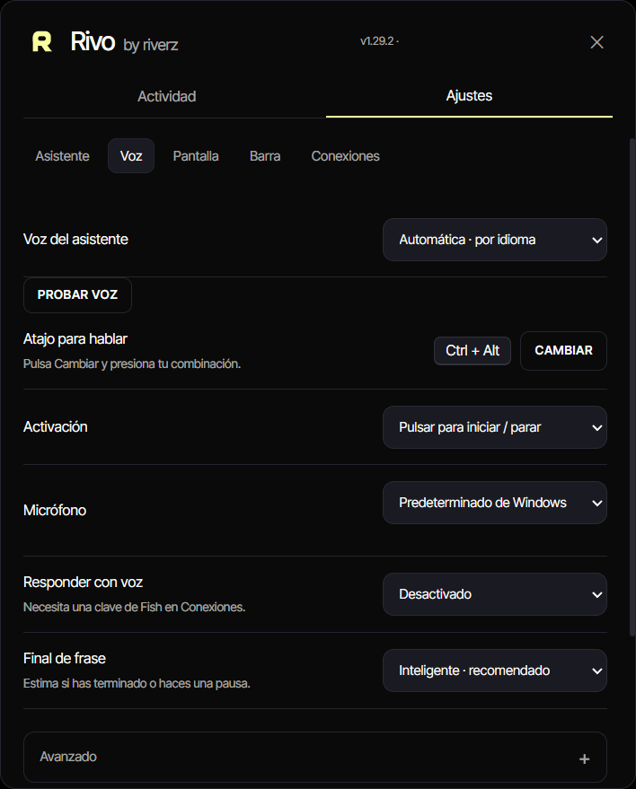

# Rivo by Riverz

**A Windows assistant for voice requests, dictation and desktop context.**

[Download and release files](https://github.com/excelenciaempire/rivo-releases/releases/latest) · [Engineering](ENGINEERING.md) · [Contact](https://github.com/excelenciaempire/riverz-showcase/issues/new?title=Professional%20inquiry)

## Inside the application

  
  

Archived native Rivo v1.29.2 QA captures: assistant settings and voice controls. Spanish/dark interface with isolated test defaults.

[Capture provenance](SCREENSHOTS.md)

## My contribution

I develop the application workflow, Windows interaction, speech/provider integrations, settings, onboarding and packaging.

Rivo supports typed or spoken requests, literal dictation and selected screen context. Dictation inserts words as text instead of interpreting them as desktop commands. Other assistant requests use structured intent and Windows tools to act on supported targets.

**Python · Windows UI Automation · Speech integrations**

**All my development work presented here was done with AI assistance.** I use programming and software engineering fundamentals to define requirements, review code, test behavior and take responsibility for technical decisions.

## Distribution

This repository distributes Windows installers and update metadata; the application source is private. See [the release page](https://github.com/excelenciaempire/rivo-releases/releases/latest) for the current version. The implementation targets Windows 10/11 x64.

Local dictation and cloud-assisted features have different requirements. Optional providers use each user's configuration and may charge for requests. Screen context and audio may be sent to the selected provider when those capabilities are enabled.

Release assets are publicly available. Installer signing and clean-machine behavior have not been independently verified in this case study.
